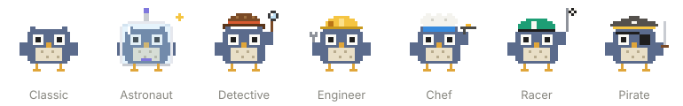

# Usage Desk

A side panel for Claude Code that shows where your usage goes, while you work.



Claude Code tells you when you hit a limit. Usage Desk shows you how close you are, which chats used the most, and why, in plain language.

## What it shows

- **Your agent**: a little owl that walks while Claude works. Press it to pick one of eight outfits, from astronaut to scientist, or press the name to rename it. Each subagent gets its own card.
- **Three bars**: the current chat's context, your 5-hour limit and your weekly limit. Press a bar to open its details.
- **Current chat**: what fills the context window, by category. Press a category to read why it's high and what you can do about it.
- **5 hours and weekly**: Claude's own percentage, then the chats and projects that used the most, with cached tokens kept separate.
- **Compact**: a big chat offers a Compact button. Where the panel can't run `/compact` itself, it puts the command in your prompt box for you to send.
- **Cache clock**: a countdown until the chat's cache goes cold, and a Keep warm button. Each Keep warm sends a tiny request, which uses a little of your limit.
- **What Claude did**: each reply and job with its tokens. Press one to see why it took that many.

## Install

You need:

- **Claude Code 2.1.275 or later**, in the terminal or the Code tab of the Claude desktop app
- **Python 3**, which is already on most Macs and Linux machines. On Windows, install it from [python.org](https://www.python.org/downloads/).

In Claude Code, run:

```
/plugin install usage-desk --marketplace dcngalves/usage-desk
```

Then start a new chat. The panel opens by itself. If you close it, type `/usage-desk` to bring it back.

On an older Claude Code, add the marketplace first, then install:

```
/plugin marketplace add dcngalves/usage-desk
/plugin install usage-desk@usage-desk
```

### Update or remove

```
/plugin marketplace update usage-desk
/plugin uninstall usage-desk
```

## What it costs in tokens

- **Installing: none.** `/plugin install` runs on your computer and never calls Claude.
- **Running: none.** The panel reads Claude Code's own logs and figures. `/usage-desk` is answered by the panel itself, not by Claude.
- **Keep warm and Compact** are the only things that use your limit, and only when you press them. Each Keep warm ping is one tiny request that re-reads the chat from cache.

Using Cowork? There's a separate version: [Usage Desk for Cowork](https://github.com/dcngalves/usage-desk-cowork).

## Your data stays on your computer

- Usage Desk reads Claude Code's own chat logs in `~/.claude/projects` and counts tokens. It never reads out or sends message text.
- It makes no network requests of its own. The only requests it makes go through Claude Code itself, when you press Keep warm or Compact.
- It saves totals per chat in `~/.claude/usage-desk/scan-state.json`, so a deleted chat still counts towards the week.

## What the figures mean

- The 5-hour and weekly percentages come from Claude. Before the first reply in a chat, they come from the desktop app's last saved reading, marked with its age. Without the desktop app, they appear after the first reply.
- Costs use Anthropic's list prices. They're estimates, not what you pay on a plan.
- Shares per chat are weighted by those prices and cover Claude Code chats only. Usage in claude.ai and Cowork counts towards your limits but isn't listed here.

## Works on

| System | Status |
| --- | --- |
| macOS | Tested |
| Windows | Should work, not yet tested |
| Linux | Should work, not yet tested |

In the terminal, the panel shows text instead of drawings.

If something doesn't work on your system, please [open an issue](https://github.com/dcngalves/usage-desk/issues).

## Credits and license

- Usage Desk is © 2026 dcngalves, released under the [MIT license](LICENSE).
- The owl is original art made for this project.
- The idea of an agent icon that walks and dresses for the kind of work, and its outfit animations, was adapted from savvy-progress in [johnnyvizz/claude-kit](https://github.com/johnnyvizz/claude-kit) (MIT). Its notice is in [THIRD-PARTY-NOTICES.md](THIRD-PARTY-NOTICES.md).
- Prices come from [Anthropic's pricing page](https://platform.claude.com/docs/en/about-claude/pricing).

Claude and Claude Code are trademarks of Anthropic, PBC. Usage Desk is an independent project and isn't affiliated with or endorsed by Anthropic.
